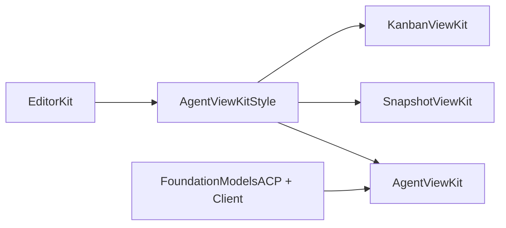

# Architecture

## No backward compatibility

This package has not shipped, and none of the swissarmyhammer packages has. We do not keep backward compatibility, and we do not write code for it.

- When a file format or an on-disk layout changes, write and read only the new one. Do not keep a reader for the old format, and do not write migration code. Data on disk in the old format may simply stop working.
- When an API changes, change every caller in the same change, or in the packages that depend on it. Do not keep deprecated aliases, shims, or old overloads.
- Do not keep a schema version only so that an old file can still be read.

This rule holds until we ship. When we ship, this section will say what we promise from then on.

## AgentViewKit is the shared visual layer

AgentViewKit is the shared visual layer of the view kits (user decision, 2026-10-28). SnapshotViewKit and KanbanViewKit build on it for the look that they share with an agent thread, and keep no copy of it. EditorKit holds the tokens, the theme and the editors under all of them (EditorKit `style.md`).

The package has two library products:

| Product | Target | Links | For |
| --- | --- | --- | --- |
| `AgentViewKitStyle` | `Sources/AgentViewKitStyle` | EditorKit only: `EditorStyle`, `EditorTheme`, `EditorSwiftUI`, `EditorDiff`, `EditorCommands` | Each view kit. Its dependency closure holds no ACP package, no Textual and no math engine (`AgentViewKitStyleClosureTests`). |
| `AgentViewKit` | `Sources/AgentViewKit` | `AgentViewKitStyle`, EditorKit, FoundationModelsACP, FoundationModelsACPClient, Textual, swiftui-math | An ACP client app: the agent thread views and the ACP helpers. |

`AgentViewKitStyle` holds the shared look: the content tile (`ContentTile`, `.contentTile()`, `ContentTileStack`), the selectable surface (`.selectableSurface`, `SurfaceCorners`), the shared symbol table (`SharedSymbol`), the status symbol (`StatusSymbolImage`, `.liveSymbolEffect(isActive:)`), the status bar (`StatusBar`, `StatusBar.Message`, `StatusBar.Action`), the location and file chips (`ToolCallLocationChips`, `ChipFlowLayout`, `DiffFileChip`, `DiffSummary`), the diff renderer setup (`EditorKitDiffRenderer`, `DiffLayout`, `\.diffLayout`) and the tool call scope kind (`AgentScopeKind.toolCall`).

AgentViewKit depends on the style library and re-exports it, so a host of the kit reads those types with no second import. A style view takes the behaviour that only the kit has through a style protocol of the environment, in the shape of `ButtonStyle`: the kit sets `AgentStatusBarActionStyle` (the button style of the place and the focus scope of a bar control) where it shows a `StatusBar`, and `AgentLocationChipStyle` (the inspector and the scope of the file) where it shows the location chips of a tool call.

What needs an ACP type stays in AgentViewKit: the ACP tool kind and status symbols (`ToolKindSymbol`, `ToolStatusSymbol`), the files of an ACP diff (`DiffSummary.files(of:)`), the diff view with its ACP initializer (`DiffView`), the subjects of the command scopes (`ToolCallEntry` and the others), and the agent symbols, which the kit adds to `SharedSymbol` in an extension.

## Style

AgentViewKit follows [EditorKit/style.md](../EditorKit/style.md), the one style guide for EditorKit, KanbanViewKit, AgentViewKit, SnapshotViewKit and TestudoApp. The sources of its Liquid Glass rules are in [EditorKit/Docs/research-liquid-glass.md](../EditorKit/Docs/research-liquid-glass.md).

- AgentViewKit keeps no copy of the rules. The docs and the code comments cite a rule by its number, a D-number or a section name of that guide, as EditorKit `style.md`.
- The guide says that the view kits build on AgentViewKit for the shared visuals. KanbanViewKit and SnapshotViewKit use them from AgentViewKit and keep no copy.
- `StyleGuideLinkTests` checks that this file links the guide, and that no file of the package names the old TestudoApp path of the guide or of its research page.
