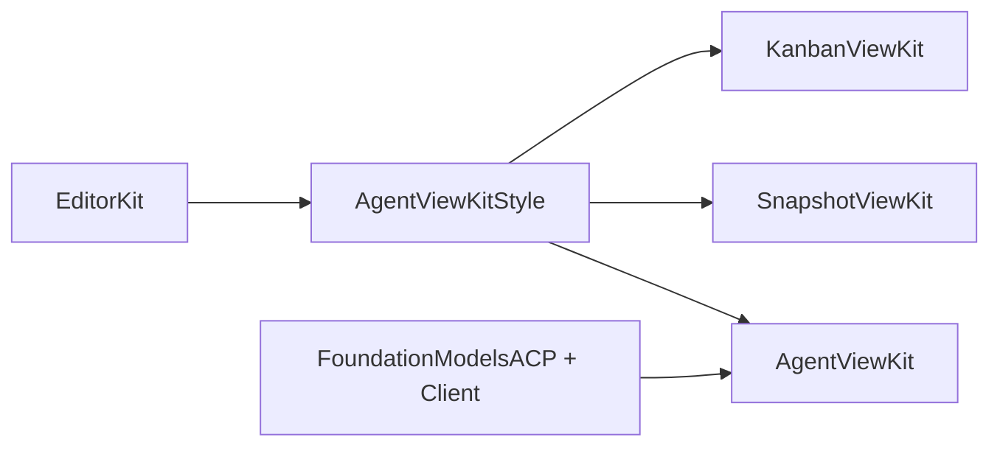

# Architecture

Shared conventions are in [EditorKit's "View kit conventions"](../EditorKit/ARCHITECTURE.md#view-kit-conventions).

## No backward compatibility

This package has not shipped, and none of the swissarmyhammer packages has. We do not keep backward compatibility, and we do not write code for it.

- When a file format or an on-disk layout changes, write and read only the new one. Do not keep a reader for the old format, and do not write migration code. Data on disk in the old format may simply stop working.
- When an API changes, change every caller in the same change, or in the packages that depend on it. Do not keep deprecated aliases, shims, or old overloads.
- Do not keep a schema version only so that an old file can still be read.

This rule holds until we ship. When we ship, this section will say what we promise from then on.

## AgentViewKit is the shared visual layer

AgentViewKit is the shared visual layer of the view kits (user decision, 2026-10-28). SnapshotViewKit and KanbanViewKit build on it for the look that they share with an agent thread, and keep no copy of it. EditorKit holds the tokens, the theme and the editors under all of them (EditorKit `style.md`).

The package has two library products:

| Product | Target | Links | For |
| --- | --- | --- | --- |
| `AgentViewKitStyle` | `Sources/AgentViewKitStyle` | EditorKit only: `EditorStyle`, `EditorTheme`, `EditorSwiftUI`, `EditorDiff`, `EditorCommands`, `EditorCommandsUI` | Each view kit. Its dependency closure holds no ACP package. |
| `AgentViewKit` | `Sources/AgentViewKit` | `AgentViewKitStyle`, EditorKit, FoundationModelsACP (with its `ACPMarkdown` product), FoundationModelsACPClient, Stencil | An ACP client app: the agent thread views and the ACP helpers. |

Two more library products, `AgentViewKitTestSupport` and `AgentViewKitDemoSupport`, are test support for the nested `IntegrationTests/` and `ScreenshotTests/` packages (see "Tests of this kit"). No host of the kit links them.



`AgentViewKitStyle` holds the shared look: the content tile (`ContentTile`, `.contentTile()`, `ContentTileStack`), the selectable surface (`.selectableSurface`, which wraps EditorKit's `.selectableItem`, also in the form that takes the focus of a focusable item, the selection-only `.selectionSurface(_:corners:)` of a part with no scope of its own, and `SurfaceCorners`), the change-highlight edge (`.changeHighlightEdge(corners:isShowing:)`, `.changeHighlightEdge(radius:isShowing:)`), the status bar (`StatusBar`, `StatusBar.Message`, `StatusBar.Action` with `reload` and `makeDismiss`), the title line of a status text (`StatusTitleLayout`, which a bar and each card with a symbol, a title and an explanation show, and `StatusTitleText`, the one catalog string of its spoken label), the shape of a stream banner (`StreamBannerContent`, and `ReloadPhase`, in which only the newest reload of an episode writes its outcome, and a host's write of `.idle` ends the episode), `DiffSummary`, the word of a diff operation (`FileDiff.Operation.label`, which SnapshotViewKit reads), the corners of a path chip (`SurfaceCorners.pathChip`) and the tool call scope kind (`AgentScopeKind.toolCall`).

Each chip of one file or folder path is EditorKit's `PathChip` (EditorSwiftUI): the file chips of a `DiffView`, the location chips of a tool call and the path rows of the inspector (a `URL` field), in SnapshotViewKit as in AgentViewKit. Neither library keeps a chip of its own for a path. The row of the location chips of a tool call (`ToolCallLocationChips`) is internal to AgentViewKit: a compound view that draws each `PathChip` in EditorKit's `EditorChipRows`, with the inspector and the scope of its file. `AttachmentChip` is another view (the type icon of the file, its size and a remove button) and stays in AgentViewKit.

The inspector of the view kits is EditorKit's `EditorInspector` (`Inspectable`, `InspectorView`, `InspectorForm`, `InspectorActionRow`, `.inspectorPreviewFrame()`). The style library keeps no copy of it; each kit, and a host that inspects, imports `EditorInspector` itself. AgentViewKit links it, and does not re-export it.

AgentViewKit depends on the style library and re-exports it, so a host of the kit reads those types with no second import. A style view takes the behaviour that only the kit has through a style protocol of the environment, in the shape of `ButtonStyle`: the kit sets `AgentStatusBarActionStyle` (the focus scope of a bar control) where it shows a `StatusBar`.

Each button of the kit is one of EditorKit's button components (EditorSwiftUI, EditorKit `style.md`, "Buttons"): `EditorButton` for an action of a card, a bar or the composer (the `.action` look takes the glass style in content and the bordered style on glass, from `.editorButtonSurface(_:)` or the `FloatingGlassContainer` above it), `EditorToolbarButton` for the bare buttons of a header or a row of actions, and `EditorMenuButton` for a button that opens a menu: the Session Options menu of `ConfigOptionsView`, the Tools menu of `ToolToggles` and the children menu of the session crumbs. The session crumbs of the header are EditorKit's `EditorBreadcrumbBar` (`SessionBreadcrumb`): each crumb opens the menu of its siblings, the bar hides the oldest ancestors in a leading overflow crumb when the width is short and wraps the last crumb, so no title is cut, and the kit keeps no collapse rule or menu look of its own. A button that runs a registered command is the command form (`EditorToolbarButton(command:)`), such as the attachment actions and Copy Thread in a command scope; a verb with a long title gives its button a short one (`CommandDefinition.buttonTitle`), such as Reveal for Reveal in Finder. A button that flips a state is the toggle form (`EditorToolbarButton(_:symbol:isOn:)`), such as the expand button of a reasoning. A squeezed button hides its caption and keeps its symbol, with its name as its accessibility label and tooltip. The kit keeps no button style of its own and adds no `.tint`, `.font` or `.buttonStyle` to a button. A row or a chip whose content is the button and a menu item stay plain `Button`s.

Each item that the kit draws itself (a row of an `AgentRowList`, a card, a chip, a file view) shows its selection and its focus as a fill in its own shape, never as an outline (EditorKit `style.md`, "Selection and focus"): `.selectableSurface` stands inside the `.commandScope` of the item, and the scope draws no focus ring. The look of an item of a thread is its `AgentItemFocusLook`: an item with no surface (a message, a tool call, the inspector of a file) keeps the ring of its scope, a card or a chip with a surface and no selection shows the focused fill, and a file view that selects its file draws the fill with its own selectable surface. An item that takes the keyboard focus itself, such as the permission card of a `RequestDeck` or a row of an `AgentRowList` that opens on a double click, gives that focus (`@FocusState`) to `.selectableSurface(_:isFocused:corners:)` (EditorKit's `.selectableItem(isSelected:isFocused:cornerRadius:)`), and shows it as the same fill, with no ring: `.focusEffectDisabled()` stands around its `.focusable()`, so SwiftUI draws no system focus ring. A part with no scope of its own inside another item, such as a file chip of a diff or a tab chip of a form, shows its selection only (`.selectionSurface(_:corners:)`), so it does not take the focus look of the scope around it. A native control keeps the system focus look.

A kit view has no outer padding (style.md rule 10, ^rgsq3k4): the layout that holds a list gives the margin of its scroll content with EditorStyle's `.scrollContentMargins(_:)` (EditorKit ^ny8zhz5), and the kit keeps no copy of it.

The row of a completion list is EditorKit's `EditorCompletionRow` (EditorComplete), and the kit keeps no copy of it. The prompt editor's list draws it with `completionRowIdentifier` and gives it `EditorCompletionRow.listMargin` as its horizontal scroll content margin, as EditorKit's popup does.

All inspection in AgentViewKit goes through EditorKit's `InspectorView`, built from EditorKit's field kinds only: no AgentViewKit view goes inside an inspector. `Sources/AgentViewKit/Inspection/` gives the client models of FoundationModelsACPClient their inspections. `ConnectionModel` and `MCPServerItem` conform as `@retroactive Inspectable`. `SessionModel` and each transcript entry conform to the kit's `InspectableClientModel`, and the inspector shows each one through an `InspectedClientModel`, a small AVK object whose `Identifiable` id is a readable `String`: EditorKit makes the object part of each scheme id from the description of that id, and `SessionId` and `TranscriptEntry.ID` have none. The id of a session is its raw session id (`sess_1`). The id of an entry from the wire is the id of its inspection, a `-` and its raw wire id (`tool-call-call_1`), `position-<n>` for an entry with no wire id, and `local-<UUID>` for an entry that the client made. `InspectorView(model)` wraps the model, so a host still writes `InspectorView(entry)`; a selection of several types holds `InspectedClientModel(entry)`. The compound views `ConfigOptionsView` (form style) and `ToolToggles` (list style) are `InspectorView`s with an inspection built from their options or tools. Their menu styles and `PermissionModePicker` build each single-value control from EditorKit's `ChoiceField` and `ToggleField`, and AgentViewKit keeps no copy of a choice or toggle control.

What needs an ACP type stays in AgentViewKit: the map from each ACP tool kind, status and priority to its EditorKit symbol and tone (`EditorSymbol+ACP.swift`), the map from each ACP and client status (tool call, plan entry, compaction, send state, MCP server, connection) to its EditorKit status token (`EditorStatus+ACP.swift`), the custom lost status of a tool call (`ToolStatusSymbol.lostWireValue`), the files of an ACP diff (`DiffSummary.files(of:)`), the diff view with its ACP initializer (`DiffView`, the review chrome around EditorKit's one-value preview, `PreviewField`, of the selected file: one unified column at the full height of its content, which the thread or the inspector scrolls; the style library keeps no diff renderer and no diff layout), the subjects of the command scopes (`ToolCallEntry` and the others), and the agent symbols (`AgentSymbol`), the concepts that only an agent thread shows; each symbol the view kits share is EditorKit's `EditorSymbol`, which the kit draws with `EditorSymbolImage`.

## One text selection in a thread

A thread has one text selection (`Docs/decisions/text-selection.md`). `ThreadTextSelection` (`Sources/AgentViewKit/Selection/`) conforms to EditorKit's `TextSelectionRegion`, and `.threadTextSelection()` puts it in the environment of `AgentThreadView` and `ConversationView`. Each text area claims the selection when the user starts a selection in it, and the claim clears the previous area. An EditorKit `EditorView` (Markdown text, code block, command output, `PreviewField`) claims for itself. A plain text that the user can select is an EditorKit `EditorLabel`, which claims for itself too, never a SwiftUI `Text` with `.textSelection(.enabled)`, because the kit cannot clear a SwiftUI selection. A selectable text of a view that shows on glass and in content, such as a request card or the explanation of a `StatusTitleLayout`, is a `PlacedLabel` (`AgentViewKitStyle`): an `EditorLabel` in the text color of its place. A right click on a label shows the menu of the item around it. A drag selection stays in one text area.

## Models of rows far from view

One rendered answer keeps about 659 KiB in its EditorKit model and editor (EditorKit benchmark, ^t9416x5). The lazy stack of `ConversationView` can keep rows that scrolled away, so the thread bounds the models itself. `ConversationView` reports the rows in view to a `LiveRowRange` (`Sources/AgentViewKit/Thread/`): the rows in view and a margin of rows on each side of them. A `ResponseView` whose row is out of that range drops its editor and its model, keeps its text, and shows an empty space of the height of its last layout. It makes a new model from its text when its row comes back. A response whose editor holds the selection of the thread (`ResponseSelectionClaim`) keeps its editor. Outside a `ConversationView`, each response keeps its model. The other views of a row with an editor, such as a code block, a terminal or a diff, keep their models.

## Search hits of a thread

A host searches the transcript itself, and gives the result to the thread with `.transcriptSearchHits(_:)` (TestudoApp D207 (f), `Sources/AgentViewKit/Thread/TranscriptSearch*.swift`). The modifier is a `View` extension that sets the environment value `\.transcriptSearchHits`, which `TranscriptSearchDriver` in the thread reads. Thus it chains with `.sideCards(_:)` and with the other modifiers of the thread in each order (^6jbm8fy). The value is a binding of `TranscriptSearchHits`, the ordered list of `TranscriptSearchHit` values, best first, so that the kit can clear it. Each hit has the wire id of its entry and its matched words (`terms`). A hit that only the cosine search found has no terms. `TranscriptSearchDriver` gives each change of the hits and of the transcript to the `TranscriptSearch` of the thread. A change of the transcript is also the link of the echo of a prompt to its local user message, which adds no entry; a streamed token is not a change. `TranscriptSearch` finds the entry of each hit by the observed `wireID` of the entries of FoundationModelsACPClient, and reveals its row with the row key of that entry. The doc of `TranscriptSearch` is the one statement of the lookup rule: the hits that it skips, and the entry of a linked prompt, which is the local user message of the prompt.

Reveal: when the hits change, the first hit whose entry the transcript holds becomes current, and `TranscriptSearch` makes a reveal request. `ConversationView` takes the request and scrolls to the row of the entry. When that row is not loaded, it loads more pages first. When no hit has an entry yet, the search waits and reveals the first hit when its entry comes. A collapsed tool call or thought that is the current hit opens.

Marks: in the entry of each hit, each match of a word of its terms (no case, no diacritics, at the start of a word) gets the find highlight of the EditorKit theme (`\.editorTheme`), not glass. A hit with no terms marks the whole entry. The current hit has the stronger mark. In an editor, the marks are the style keys of `SearchDecorations`, and EditorKit paints them with `Theme.findMatchBackground` and the stronger `Theme.findCurrentMatchBackground`. The same keys mark the text of a plan entry (`EditorLabel.editorMarks(_:)`) and the patch text of the default diff renderer (`PreviewField.editorMarks(_:)`, in the inline document or in each column). The SwiftUI marks, the title of a tool call and the whole entry, use the same two colors through `TranscriptSearchMark.highlight(in:)`, so all the search marks agree (D110 (e)). The find colors are weak tints with a contrast of at least 4.5:1 with the text, so the whole entry gets the color with no added opacity.

Next and previous: the kit verbs Find Next Hit (⌘G) and Find Previous Hit (⇧⌘G) of the group `agent.find` call `TranscriptSearch.step(forward:)`, which makes the next or the previous entry with a hit current in the order of the transcript, through the same reveal request. At the end, the step wraps and plays the beep of the search (`NSSound.beep()`, a seam for the tests). ⌘G and ⇧⌘G follow D137 (a), not the ⌃⌘ rule of the kit commands. The kit verb Clear Search Hits (`agent.clearSearchHits`, Esc) of the same group sets the binding of the host to `nil`. The three verbs read the first responder of the window through the mount of the scope (`TextInputFocus`): while a text input has the focus, they are not available, so ⌘G stays the find of the editor (D133) and Esc stays the Esc of the text input. Esc is the first chord of Clear Search Hits and a secondary chord of Stop, and the scope binds the first chords before the secondary chords, so Clear Search Hits gets Esc before Stop: while the thread has hits, Esc removes them; with no hits, Clear Search Hits does not take the key, and Esc goes on to Stop and then to `nav.drillOut`. With hits while the agent runs, the first Esc removes the hits and the second Esc stops the agent. Clear Search Hits shows in the find group of the Edit menu and in the palette only while it is available (`AgentCommandVerb.isShownOnlyWhenAvailable`: its `isVisible` gate reads the availability of its command), so no disabled row shows with no hits. The thread registers no EditorKit Cancel (`edit.cancel`), so the Edit menu shows no "Cancel" row from the thread. `TranscriptSearchDriver` announces each new current hit with its place and the author of its entry ("Hit 2 of 7, You") through the `announcer` of the environment.

## The status line

The header of the top bar of `AgentThreadView` is the status line (`Sources/AgentViewKit/StatusLine/`, AVK-10, TestudoApp D194), as the status line of `sah statusline` and starship. The configuration is typed: `StatusLineDefinition` has a `StatusLineFormat` of `$module` references and one options struct for each module. `StatusLines` has the builtin presets `default`, `minimal` and `full`, as `ModelProfiles` of Router. A host decodes the `statusline` setting with `StatusLineSetting.resolve(_:)`, which gives the definition and the problems with their key paths, and gives the definition with `.statusLine(_:)`. `StatusLineDefinition.settingsKeys` is the key list that the settings store of FoundationModelsACPAgent checks; `StatusLineSchemaParityTests` keeps the two lists equal. `StatusLineModel` reads the git state and the files of the folder off the main actor through `StatusLineGitProbing` (`LibGit2StatusLineProbe`: libgit2 in the process, never a `git` program), follows FSEvents with a delay of 0.5 s, and reads again at the end of each turn. It also reads the Finder display names of the folder and of the folders above it, through a resolver that a test can replace. `StatusLineDirectory` makes the path of the `directory` module: whole Finder names with ` › ` between them, iCloud Drive and its app containers as Finder names them, `~` for the real home folder of the user (`UserHomeFolder`, from the user database, not the container folder of a sandboxed app), and one `…` in place of the middle folders of a long path. `StatusLineRenderer` turns a definition and a `StatusLineInput` into styled spans, and gives the full path of the folder as the tooltip and the accessibility value of the `directory` module; `StatusLineView` draws them with the UI font and the colors of the theme, and a click on a module runs the host action of `.statusLineActions(_:)`. The language icons are Simple Icons (CC0) in `Resources/LanguageIcons`.

## Side cards

A side card of `/btw` (D205) is a `SideQuestionCard` (`Sources/AgentViewKit/Thread/`). The host runs the side question in a session of its own, the fork, and gives its `SessionModel` to the card. The kit does not change a session. Each card is an item scope of its own, `agentSideCard:<sessionId>`, that registers the `SideCardVerb` commands (Send to Chat, Open, Close, the group `agent.sideCard`) at its own path, as an attachment scope does (`Sources/AgentViewKit/Commands/SideCardCommands.swift`, `SideCardScope.swift`). Thus the buttons, the context menu, the Session menu, the palette and Escape run one command on one card. Send to Chat inserts its text through the composer hook of the thread scope, the path of Mention…. While the fork needs input, Send to Chat is not available and the card shows Open and Close only. Close is always available, so the user can always dismiss a side question. `.sideCards(_:)` shows the cards in the overlay of the floating controls, above the composer, so the cards do not change the bottom inset of the list or the scroll position. The modifier is a `View` extension that sets the environment value `\.sideCards`, which `AgentThreadView` reads, as the modifiers of the status line do. Thus it chains with `.transcriptSearchHits(_:)` and with the other modifiers of the thread in each order (^6jbm8fy). A host applies it on the thread view: each thread view below the modifier shows the cards.

## Read-only thread

A shared session (TestudoApp D208 (i)) is a read-only `SessionModel` of FoundationModelsACPClient: `SessionModel(snapshot:sessionId:)` makes it from a `SessionSnapshot` of `ACPMarkdown`, with no connection, and its `isReadOnly` is `true`. The thread reads `isReadOnly` and does not change the model.

- `AgentThreadView` shows no composer slot for it (`AgentThreadLayout.showsComposer(for:)`): no composer, no request deck in the slot, and no mode or model picker of the accessory. The kit keeps no queue of prompts. A read-only model has no pending request, so a `RequestDeck` next to the view shows no card: no permission buttons and no elicitation form.
- The thread scope does not register the verbs of the groups that change the session (`AgentCommandGroup.changesSession`: `compose`, `control` and `fork`), through `AgentCommandTarget.registers(_:)`, the same gate as the fork action of the host. Thus Send Message, Focus Composer, Mention…, Stop, Approve Request, Reject Request and Fork from Here are absent from the menus, the context menus, the palette and the keys, with no disabled row. The verbs that read stay: Copy Message, Copy Thread, Copy Code Block, Export as Markdown…, Find Next Hit, Find Previous Hit, Clear Search Hits and the navigation verbs.
- The action row of a message (`MessageActions`) shows only Copy, Copy thread and Export: no Fork, Retry or Edit.
- The status line has no control that changes the session (D193 (f)); it shows only when the host gives a connection model.
- When the host gives a newer snapshot with `replace(with:)`, each entry that stays keeps its object and its id, and each new entry goes at the end. The row key of an entry comes from its id, so the rows and the scroll anchor stay, and the list counts the new rows for the scroll-to-bottom pill while the reader is not at the end. A snapshot with a different start rebuilds the transcript.
- The read-only thread adds no surface and no glass: the content keeps the rules of D110 (b).
- A host fills the header slot above the transcript with `.threadHeader { }` (`Sources/AgentViewKit/Thread/ThreadHeader.swift`), for "Shared by <name> · Updated <date>". The kit gives the slot, and the host gives the view and its strings. The header stands in the top bar, below the status line and above the banners, as content with no glass. It is one accessibility group, `thread-header`, and the views of the host keep their labels.
- A host shows a message in place of the transcript with `.threadUnavailable(_:)` (`ThreadUnavailable.swift`), for "The owner stopped sharing this session."; `nil` shows the transcript. `ThreadTranscriptSlot` shows the message as a static text, `thread-unavailable`, in the center, with no glass. The header, the banners and the floating controls stay; the scroll-to-bottom pill goes, because no list shows. The thread gives the state to its `AgentCommandTarget` through the mount of the scope (`isSessionUnavailable`). Then the verbs that need the transcript (`AgentCommandVerb.needsTranscript`) are not available, with the reason "The session is not available.": the verbs of `clipboard`, `export` and `find`, which read the text of the session, and Next Prompt, Previous Prompt, Scroll to Bottom and Expand or Collapse All of `navigate`, which act on the list. The other verbs of `navigate` stay: Next Request and Previous Request act on the request deck, and Go to Parent Session, Open Child Session, Next Sibling Session, Previous Sibling Session and Jump to Session act on the session tree.
- The two modifiers are `View` extensions that set the environment values `\.threadHeader` and `\.threadUnavailable`, which `AgentThreadView` reads, as `.sideCards(_:)` and `.transcriptSearchHits(_:)` do. Thus the four chain in each order, and they work on each thread, read-only or not.

## Text built from a list

No separator and no order of parts is in code (^3b8m474, `Docs/decisions/text-templates.md`). A text with a layout of its own is a Stencil template of `Sources/AgentViewKit/Resources/Templates`, which `TextTemplates` (`Sources/AgentViewKit/Text/`) renders from a model: the copy text of a thread, and the plan steps of the inspector. The Markdown export of a thread (Export as Markdown…, D202) is not a template of the kit: `SessionModel.markdown(options:)` of FoundationModelsACPClient renders it with `SessionMarkdown` of ACPMarkdown, and the kit gives the words of its catalog (`MarkdownExportLabels`). A chain of parts, a path of names or a run of sentences, is a two-part pattern of the string catalog that `ChainText` applies. The words of a template come from the catalog through its model, so no template is localized.

## Style

AgentViewKit follows [EditorKit/style.md](../EditorKit/style.md), the one style guide for EditorKit, KanbanViewKit, AgentViewKit, SnapshotViewKit and TestudoApp. The sources of its Liquid Glass rules are in [EditorKit/Docs/research-liquid-glass.md](../EditorKit/Docs/research-liquid-glass.md).

- AgentViewKit keeps no copy of the rules. The docs and the code comments cite a rule by its number, a D-number or a section name of that guide, as EditorKit `style.md`.
- The guide says that the view kits build on AgentViewKit for the shared visuals. KanbanViewKit and SnapshotViewKit use them from AgentViewKit and keep no copy.
- Every typing surface is an EditorKit editor (`style.md`, "Text input"): `EditorView` or `SingleLineField`, never a system text input or `.searchable`.
- A fixed bound of a view around text, such as the height of the composer or the width of a card, is named in points at the default theme font, and the view scales it with `ThemeFontScale` of its font role (^dcs0pbj). The factor is the size of the theme font over the default size, so it needs no theme token and the bound does not move at the default font. The controls of a media player do not shrink, so a player only grows.
- A sheet is chrome: a host marks the root of each sheet that it presents with `.onChrome()`, because the kit cannot see that a view stands in a sheet (^dcs0pbj). The demo's settings sheet does.
- Review enforces the rules of `style.md` and the rules of the kit (user decision of 2026-10-30, ^v0nj72). No test reads the source or the docs of the package as text.

## Tests of this kit

The tiers, the test names, the gallery and the rule against measuring pixels are EditorKit's [View kit conventions](../EditorKit/ARCHITECTURE.md#view-kit-conventions). What is particular to AgentViewKit:

- `AgentViewKitDemoSupport` is a library product beside `AgentViewKitTestSupport`, because a test target of the root package cannot be a dependency and the demo app, `IntegrationTests/` and `ScreenshotTests/` all use the scripted agents. No host of the kit links either one.
- The failed turn with its sign-in card is the one fixture of both nested packages: `IntegrationTests/Tests/IntegrationTests/Helpers/FailedTurnFixtures.swift`, with a symlink in `ScreenshotTests/Tests/ScreenshotTests`.
- The gallery shows the key screens of `ReviewGalleryScreen` with the dated notes of `ReviewGalleryNotes`, then the images of `HostedSnapshotTests` and `GlassSnapshotTests`. The page test records those images first, so the order of the suites does not matter.
- A hosted test drives a view through accessibility (^b2h8hpz): it finds an element by its accessibility identifier and does its action with `perform(_:on:)` (`.press`, `.increment`, `.custom(name)`, `.focus`, `.pick(option)`, `.showMenu`, which returns the menu it opened), which needs exactly one element with the identifier, or with the `InspectorDriver` verbs, in the harness window, which is never ordered in and never key. A test clicks only where the hit test is the behaviour under test. A click through the event queue makes the window key off the screen, so each such test stands in a suite whose name ends in `PointerHostedTests`; the click on the scrub rail of `ThreadMinimapView` and the context menu reads (`contextMenu(at:)`, `contextMenu(identifier:)`) send no event to the window and take no focus. A test reads a context menu by its element (^wwq1cqm): `contextMenuItems(of:)` for a `.commandContextMenu`, with the command id of each row, and `contextMenu(identifier:)` for a plain `.contextMenu`. It reads a menu at a point with `contextMenu(at:)` only where the area that the menu covers is under test, in a `PointerHostedTests` suite (`AgentRowListRowMenuPointerHostedTests`).
- No AgentViewKit test needs `.machineSerially`: each pasteboard test uses an isolated pasteboard, and no test posts a window server event, writes the shared defaults or opens a file with the workspace.

## Allowed build warning

A build is clean when AgentViewKit's own targets give no warning. One warning from a dependency is allowed, and a run that shows it is still green:

```
warning: missing creator for mutated node: ('…/mlx-swift_Cmlx.bundle/Contents/MacOS')
```

- It comes from Swift Build, not from AgentViewKit or mlx-swift. Swift Build counts the `.metal` files of a resource bundle as sources that produce a binary, so code signing names the bundle's `Contents/MacOS` folder, which no step creates. Any package with Metal shaders in a resource bundle gets it.
- AgentViewKit needs MLX, and every mlx-swift version ships `.metal` sources, so AgentViewKit cannot remove it. The native build system drops the compiled `default.metallib`, so it is no way out.
- The Metal compiler warnings from mlx-swift's own shader headers are allowed for the same reason.
- When Swift Build no longer counts `.metal` files as making a binary (`willProduceBinary` in `SWBTaskConstruction/TaskProducers/TaskProducer.swift`), the warning goes away and this note goes with it.
