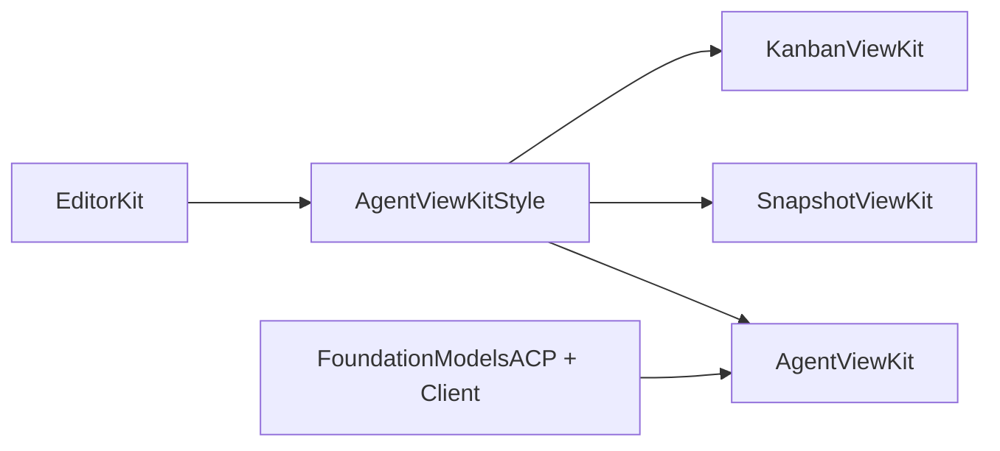

# Architecture

Shared conventions are in [EditorKit's "View kit conventions"](../EditorKit/ARCHITECTURE.md#view-kit-conventions).

## No backward compatibility

This package has not shipped, and none of the swissarmyhammer packages has. We do not keep backward compatibility, and we do not write code for it.

- When a file format or an on-disk layout changes, write and read only the new one. Do not keep a reader for the old format, and do not write migration code. Data on disk in the old format may simply stop working.
- When an API changes, change every caller in the same change, or in the packages that depend on it. Do not keep deprecated aliases, shims, or old overloads.
- Do not keep a schema version only so that an old file can still be read.

This rule holds until we ship. When we ship, this section will say what we promise from then on.

## AgentViewKit is the shared visual layer

AgentViewKit is the shared visual layer of the view kits (user decision, 2026-10-28). SnapshotViewKit and KanbanViewKit build on it for the look that they share with an agent thread, and keep no copy of it. EditorKit holds the tokens, the theme and the editors under all of them (EditorKit `style.md`).

The package has two library products:

| Product | Target | Links | For |
| --- | --- | --- | --- |
| `AgentViewKitStyle` | `Sources/AgentViewKitStyle` | EditorKit only: `EditorStyle`, `EditorTheme`, `EditorSwiftUI`, `EditorDiff`, `EditorCommands` | Each view kit. Its dependency closure holds no ACP package, no Textual and no math engine. |
| `AgentViewKit` | `Sources/AgentViewKit` | `AgentViewKitStyle`, EditorKit, FoundationModelsACP, FoundationModelsACPClient, Textual, swiftui-math | An ACP client app: the agent thread views and the ACP helpers. |

Two more library products, `AgentViewKitTestSupport` and `AgentViewKitDemoSupport`, are test support for the nested `IntegrationTests/` and `ScreenshotTests/` packages (see "Tests of this kit"). No host of the kit links them.



`AgentViewKitStyle` holds the shared look: the content tile (`ContentTile`, `.contentTile()`, `ContentTileStack`), the selectable surface (`.selectableSurface`, `SurfaceCorners`), the change-highlight edge (`.changeHighlightEdge(corners:isShowing:)`, `.changeHighlightEdge(radius:isShowing:)`), the shared symbol table (`SharedSymbol`), the status symbol (`StatusSymbolImage`, `.liveSymbolEffect(isActive:)`), the status bar (`StatusBar`, `StatusBar.Message`, `StatusBar.Action` with `reload` and `makeDismiss`), the title line of a status text (`StatusTitleLayout`, which a bar and each card with a symbol, a title and an explanation show), the empty state in the `ui` font role (`EmptyStateView`), the secondary text of a view that shows on glass and in content (`\.placedSecondary`, `\.showsVibrantText`, `.onChrome()`), the shape of a stream banner (`StreamBannerContent`, and `ReloadPhase`, in which only the newest reload of an episode writes its outcome, and a host's write of `.idle` ends the episode), the form of an inspector (`InspectorForm`, `.inspectorPreviewFrame()`), the row of its actions (`InspectorActionRow`), the row of a completion list (`CompletionRow`), the location and file chips (`ToolCallLocationChips`, `ChipFlowLayout`, `DiffFileChip`, `DiffFileLabel`, `DiffSummary`), the diff renderer setup (`EditorKitDiffRenderer`, `DiffContentView`, `DiffLayout`, `\.diffLayout`) and the tool call scope kind (`AgentScopeKind.toolCall`).

AgentViewKit depends on the style library and re-exports it, so a host of the kit reads those types with no second import. A style view takes the behaviour that only the kit has through a style protocol of the environment, in the shape of `ButtonStyle`: the kit sets `AgentStatusBarActionStyle` (the button style of the place and the focus scope of a bar control) where it shows a `StatusBar`, and `AgentLocationChipStyle` (the inspector and the scope of the file) where it shows the location chips of a tool call.

A kit view has no outer padding (style.md rule 10, ^rgsq3k4): the layout that holds a list gives the margin of its scroll content with EditorStyle's `.scrollContentMargins(_:)` (EditorKit ^ny8zhz5), and the kit keeps no copy of it.

What needs an ACP type stays in AgentViewKit: the ACP tool kind and status symbols (`ToolKindSymbol`, `ToolStatusSymbol`), the files of an ACP diff (`DiffSummary.files(of:)`), the diff view with its ACP initializer (`DiffView`), the subjects of the command scopes (`ToolCallEntry` and the others), and the agent symbols, which the kit adds to `SharedSymbol` in an extension.

## Style

AgentViewKit follows [EditorKit/style.md](../EditorKit/style.md), the one style guide for EditorKit, KanbanViewKit, AgentViewKit, SnapshotViewKit and TestudoApp. The sources of its Liquid Glass rules are in [EditorKit/Docs/research-liquid-glass.md](../EditorKit/Docs/research-liquid-glass.md).

- AgentViewKit keeps no copy of the rules. The docs and the code comments cite a rule by its number, a D-number or a section name of that guide, as EditorKit `style.md`.
- The guide says that the view kits build on AgentViewKit for the shared visuals. KanbanViewKit and SnapshotViewKit use them from AgentViewKit and keep no copy.
- Every typing surface is an EditorKit editor (`style.md`, "Text input"): `EditorView` or `SingleLineField`, never a system text input or `.searchable`.
- A fixed bound of a view around text, such as the height of the composer or the width of a card, is named in points at the default theme font, and the view scales it with `ThemeFontScale` of its font role (^dcs0pbj). The factor is the size of the theme font over the default size, so it needs no theme token and the bound does not move at the default font. The controls of a media player do not shrink, so a player only grows.
- Review enforces the rules of `style.md` and the rules of the kit (user decision of 2026-10-30, ^v0nj72). No test reads the source or the docs of the package as text.

## Tests of this kit

The tiers, the test names, the gallery and the rule against measuring pixels are EditorKit's [View kit conventions](../EditorKit/ARCHITECTURE.md#view-kit-conventions). What is particular to AgentViewKit:

- `AgentViewKitDemoSupport` is a library product beside `AgentViewKitTestSupport`, because a test target of the root package cannot be a dependency and the demo app, `IntegrationTests/` and `ScreenshotTests/` all use the scripted agents. No host of the kit links either one.
- The failed turn with its sign-in card is the one fixture of both nested packages: `IntegrationTests/Tests/IntegrationTests/Helpers/FailedTurnFixtures.swift`, with a symlink in `ScreenshotTests/Tests/ScreenshotTests`.
- The gallery shows the key screens of `ReviewGalleryScreen` with the dated notes of `ReviewGalleryNotes`, then the images of `HostedSnapshotTests` and `GlassSnapshotTests`. The page test records those images first, so the order of the suites does not matter.
- No AgentViewKit test needs `.machineSerially`: each pasteboard test uses an isolated pasteboard, and no test posts a window server event, writes the shared defaults or opens a file with the workspace.

## Allowed build warning

A build is clean when AgentViewKit's own targets give no warning. One warning from a dependency is allowed, and a run that shows it is still green:

```
warning: missing creator for mutated node: ('…/mlx-swift_Cmlx.bundle/Contents/MacOS')
```

- It comes from Swift Build, not from AgentViewKit or mlx-swift. Swift Build counts the `.metal` files of a resource bundle as sources that produce a binary, so code signing names the bundle's `Contents/MacOS` folder, which no step creates. Any package with Metal shaders in a resource bundle gets it.
- AgentViewKit needs MLX, and every mlx-swift version ships `.metal` sources, so AgentViewKit cannot remove it. The native build system drops the compiled `default.metallib`, so it is no way out.
- The Metal compiler warnings from mlx-swift's own shader headers are allowed for the same reason.
- When Swift Build no longer counts `.metal` files as making a binary (`willProduceBinary` in `SWBTaskConstruction/TaskProducers/TaskProducer.swift`), the warning goes away and this note goes with it.
