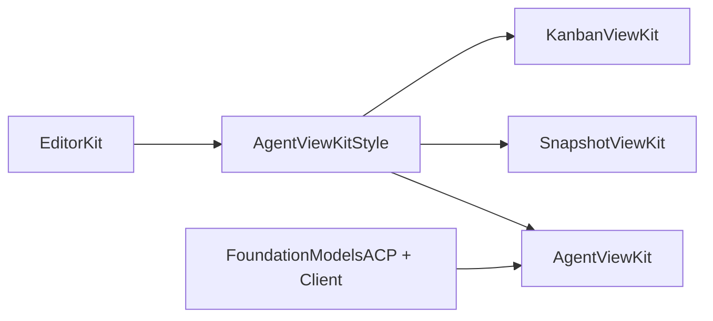
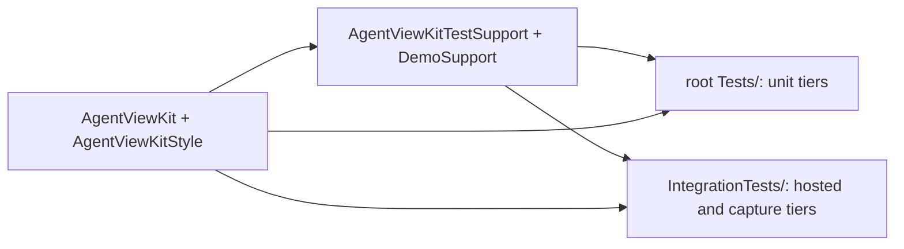

# Architecture

## No backward compatibility

This package has not shipped, and none of the swissarmyhammer packages has. We do not keep backward compatibility, and we do not write code for it.

- When a file format or an on-disk layout changes, write and read only the new one. Do not keep a reader for the old format, and do not write migration code. Data on disk in the old format may simply stop working.
- When an API changes, change every caller in the same change, or in the packages that depend on it. Do not keep deprecated aliases, shims, or old overloads.
- Do not keep a schema version only so that an old file can still be read.

This rule holds until we ship. When we ship, this section will say what we promise from then on.

## AgentViewKit is the shared visual layer

AgentViewKit is the shared visual layer of the view kits (user decision, 2026-10-28). SnapshotViewKit and KanbanViewKit build on it for the look that they share with an agent thread, and keep no copy of it. EditorKit holds the tokens, the theme and the editors under all of them (EditorKit `style.md`).

The package has two library products:

| Product | Target | Links | For |
| --- | --- | --- | --- |
| `AgentViewKitStyle` | `Sources/AgentViewKitStyle` | EditorKit only: `EditorStyle`, `EditorTheme`, `EditorSwiftUI`, `EditorDiff`, `EditorCommands` | Each view kit. Its dependency closure holds no ACP package, no Textual and no math engine (`AgentViewKitStyleClosureTests`). |
| `AgentViewKit` | `Sources/AgentViewKit` | `AgentViewKitStyle`, EditorKit, FoundationModelsACP, FoundationModelsACPClient, Textual, swiftui-math | An ACP client app: the agent thread views and the ACP helpers. |

Two more library products, `AgentViewKitTestSupport` and `DemoSupport`, are test support for the nested `IntegrationTests/` package (see "Test tiers"). No host of the kit links them.

`AgentViewKitStyle` holds the shared look: the content tile (`ContentTile`, `.contentTile()`, `ContentTileStack`), the selectable surface (`.selectableSurface`, `SurfaceCorners`), the shared symbol table (`SharedSymbol`), the status symbol (`StatusSymbolImage`, `.liveSymbolEffect(isActive:)`), the status bar (`StatusBar`, `StatusBar.Message`, `StatusBar.Action`), the location and file chips (`ToolCallLocationChips`, `ChipFlowLayout`, `DiffFileChip`, `DiffSummary`), the diff renderer setup (`EditorKitDiffRenderer`, `DiffLayout`, `\.diffLayout`) and the tool call scope kind (`AgentScopeKind.toolCall`).

AgentViewKit depends on the style library and re-exports it, so a host of the kit reads those types with no second import. A style view takes the behaviour that only the kit has through a style protocol of the environment, in the shape of `ButtonStyle`: the kit sets `AgentStatusBarActionStyle` (the button style of the place and the focus scope of a bar control) where it shows a `StatusBar`, and `AgentLocationChipStyle` (the inspector and the scope of the file) where it shows the location chips of a tool call.

A kit view has no outer padding (style.md rule 10, ^rgsq3k4): the layout that holds a list gives the margin of its scroll content with EditorStyle's `.scrollContentMargins(_:)` (EditorKit ^ny8zhz5), and the kit keeps no copy of it.

What needs an ACP type stays in AgentViewKit: the ACP tool kind and status symbols (`ToolKindSymbol`, `ToolStatusSymbol`), the files of an ACP diff (`DiffSummary.files(of:)`), the diff view with its ACP initializer (`DiffView`), the subjects of the command scopes (`ToolCallEntry` and the others), and the agent symbols, which the kit adds to `SharedSymbol` in an extension.

## Style

AgentViewKit follows [EditorKit/style.md](../EditorKit/style.md), the one style guide for EditorKit, KanbanViewKit, AgentViewKit, SnapshotViewKit and TestudoApp. The sources of its Liquid Glass rules are in [EditorKit/Docs/research-liquid-glass.md](../EditorKit/Docs/research-liquid-glass.md).

- AgentViewKit keeps no copy of the rules. The docs and the code comments cite a rule by its number, a D-number or a section name of that guide, as EditorKit `style.md`.
- The guide says that the view kits build on AgentViewKit for the shared visuals. KanbanViewKit and SnapshotViewKit use them from AgentViewKit and keep no copy.
- Every typing surface is an EditorKit editor (`style.md`, "Text input"): `EditorView` or `SingleLineField`, never a system text input or `.searchable`. `StyleRuleEngineTests` runs EditorKit's `textInputControls` engine over `Sources/` and `Examples/`, with no allowed file: a cast to the editor's own text view builds nothing, so it is not banned.
- The source rules of `style.md` that a pattern of code finds (text input, font roles, theme injection, fixed colors, content fills, system structure, glass placement, offscreen renderers, outer spacing, SF Symbol names, the hosted serial trait and the preview coverage) run as EditorKit's `EditorTestSupport` engines in one suite, `StyleRuleEngineTests`, with the roots and the allow list of this package. AgentViewKit keeps no scanner of its own for these rules; its other structure suites hold the rules of the kit alone.
- `StyleGuideLinkTests` checks that this file links the guide, and that no file of the package names the old TestudoApp path of the guide or of its research page.

## Review gallery

The review gallery is one page, `~/Library/Caches/AgentViewKit/screenshot-check/index.html` (EditorKit `style.md`, "Review gallery"). The user reviews the look of the kit there; there is no manual check.

- A run of the integration package (`swift test --package-path IntegrationTests`, see "Test tiers") writes the page again. The root `swift test` does not. `ReviewGalleryScreenTests` builds it with EditorKit's `ReviewGallery` helper (`ReviewGallery(package: "AgentViewKit").record(_:snapshotRoots:)` of `EditorTestSupport`), and `ReviewGalleryPathTests` pins the path. AgentViewKit keeps no gallery code of its own.
- The page shows the key screens first: the thread, the request deck, the banners, the sign-in prompt, the scrolled list, the attachment inspector and the gallery columns, each captured from a real window in Light and in Dark, with its dated note (`ReviewGalleryNotes`).
- Then it shows every reference PNG under `IntegrationTests/Tests/AgentViewKitIntegrationTests/Snapshots/__Snapshots__/**`, grouped by suite, with Light and Dark side by side. Discovery needs no registration, so a new snapshot shows up on its own.
- The test fails when the page does not show a reference PNG or a key screen.

## Test tiers

The tests have two tiers, and a package boundary separates them (plan.md §11 decision 21), as in EditorKit and TestudoApp:

| Tier | Package | Targets | Holds | Runs |
| --- | --- | --- | --- | --- |
| Unit | the root package | `AgentViewKitTests`, `AgentViewKitStyleTests`, `PackageStructureTests`, `ReadmeSnippetsTests` | the models, the commands, the wire, the scripted agents and the source scans. No window, no hosting view, no capture (`RootTestsHostNoViewTests`). | `swift test`, on each change: the per-card gate. |
| Integration | `IntegrationTests/`, which depends on the root package by path | `AgentViewKitIntegrationTests`, `AgentViewKitStyleIntegrationTests` | each test that mounts a view in EditorKit's `HostedViewHarness`, an `NSHostingView` or a window, each capture of a real window, the snapshot and pixel tests, the focus rings and the review gallery. | `swift test --package-path IntegrationTests`, once per batch, and in the integration job of CI (`integration-package-path`). |

- A test target of the root package cannot be a dependency, so a fixture that both tiers use lives once in `Sources/AgentViewKitTestSupport`, a test support product. `DemoSupport` is a product for the same reason. No host of the kit links either one.
- A helper that only the integration tests use lives in the integration target. A test that reads the package sources as text (a source scan) stays in the root package: EditorKit's `PackageFiles()` takes the nearest `Package.swift` above the test file, which is `IntegrationTests/` for an integration test.
- The source scans of `PackageStructureTests` read `IntegrationTests/Tests` too, so the rules of the test code hold in both packages. EditorKit's `HostedSerialScanner` (`StyleRuleEngineTests`) holds the `.hostedSerially` trait on each suite or test there that mounts a window.
- The integration package names the root package after the folder of the checkout, because SwiftPM names a path dependency after its directory: `AgentViewKit` in a clone, the folder name in a git worktree.
